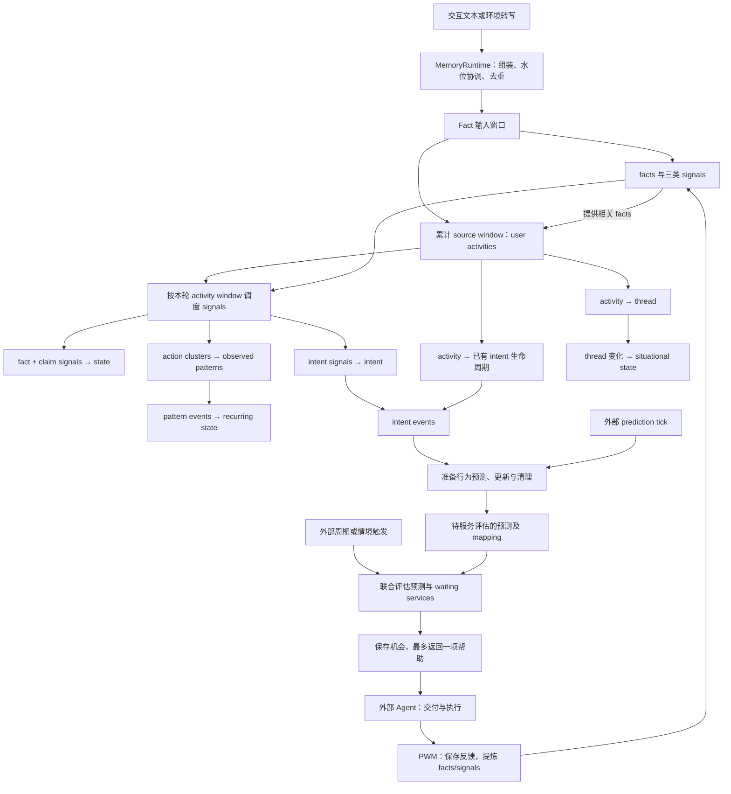

# Personal World Model：系统定位、四个模块与当前能力

> 更新日期：2026 年 11 月 23 日
>
> 文档用途：介绍 PWM 的模块职责、当前数据流、对外接口及实现边界。
>
> 依据：当前工作区代码。下文区分已实现机制与后续目标；代码链路接通不等于其语义准确性、预测准确率和真实服务价值已完成验证。

## 一、系统定位与模块分工

Personal World Model（PWM，个人世界模型）的目标是：**持续收集用户个人世界中的信息，持续更新对用户的理解，预测用户可能的行为与需要，并支持助手在合适的时候提供帮助。**

面向智能眼镜与 Personal Agent，PWM 维护一个具体用户的经历、持续事项、未来安排、行为规律和个人状态。它既提供对用户的当前理解，也持续维护未来判断及帮助机会。当前通过结构化存储、LLM 推理、检索与任务调度实现这些能力，并非独立训练的基础大模型。

| 模块 | 核心问题 | 当前主要实现 |
| --- | --- | --- |
| UserMemory | 用户个人世界中有哪些值得保存的信息？用户实际参与了什么、正在推进什么、未来要做什么？ | `MemoryRuntime`、`MemoryContextManager`、`MemoryNodeManager`、`UserThreadUpdater`、`UserMemoryDB` |
| UserState | 哪些证据足以描述用户本人的稳定倾向、重复行为或当前个人处境？ | `UserStateResolver`，状态存入 `UserModelDB` |
| UserPrediction | 在给定预测窗口内，用户可能采取什么行为？已有预测是否仍成立？ | `UserPrediction`，当前重点是意图相关的准备行为 |
| UserProactivePolicy | 当前是否值得帮助用户，提供什么帮助，还是继续等待或不介入？ | 代码类名为 `UserProactiveService`，维护帮助机会并返回 Agent 指引 |

这四者是职责划分，不代表工程中存在四个同名类。统一组合入口是 [PersonWorldModel](/Users/byzhou/Documents/xreal/project/agent/agent_memory/src/pwm_manager.py)，其中类名实际为 `PersonWorldModel`。

PWM 与外部 Agent 的分工如下：

- PWM 负责个人信息建模、状态维护、预测、帮助决策和反馈信息提炼。
- Agent 负责与用户交互、调用工具、执行具体任务，并回传执行结果与用户反馈。
- 外部宿主提供传感器或业务情境、时间 tick、Agent 能力与授权信息。PWM 当前没有内置持续运行的传感器监测和墙上时钟轮询器。

必须区分：**提炼的信息、用户的意图、系统的状态判断、未来预测、服务建议、真实执行结果**。预测不是用户承诺，`ready` 服务也不表示已经投递或执行。

## 二、UserMemory：保存信息、持续事项与用户意图

### 2.1 输入、窗口与批处理

`PersonWorldModel.accept_memory_input()` 接收两类输入，每次选择其中一种：

| 输入 | 内部表示 | 处理特点 |
| --- | --- | --- |
| `interaction_turn` | `MemoryUnit(unit_type="interaction")` | 用户与助手的一轮交流保留在同一个 unit 中，texts/speakers 及起止时间均为列表 |
| `transcript_segments` | 聚合后的 `MemoryUnit(unit_type="transcript")` | 一次接收完整 ASR 批次，先规范化，再将短转写片段组装为 unit |

本人和助手的交互标签为 `speaker_用户本人`、`speaker_助手`。环境说话人的本人身份需要上游或测试脚本提供可靠标注；已知用户别名由记忆库保存，并提供给 fact 提炼使用。

`MemoryRuntime` 负责输入组装、环境 ASR 水位协调、相邻交互与转写内容去重，以及向共享调度器提交任务。开启环境录制时，两种 unit 均受 ASR 覆盖协调；环境录制状态不等同于输入类型。

当前 fact 窗口直接由 pending units 构成：

- 按 token 目标、token 上限、unit 数量、interaction unit 数量和时间间隔判断是否提交。
- 常规触发统一提交已有 pending units，新的 incoming unit 留给下一窗口。
- **已取消 chapter 切分及用于窗口切分的 unit embedding 计算。**
- preceding context 采用上一已提交批次的连续完整 unit 尾部，受软 token 预算控制；它用于理解当前输入，不是重复提炼旧信息的独立来源。
- `finalize_memory_session()` 提交尾部输入、活动和最终 signal 调度边界；成功 flush 后清空 preceding context，不等待所有异步任务完成。

User activity 使用覆盖范围更大的 source window，由 `MemoryContextManager` 根据累计输入量、持续时间及最终 flush 决定触发。它不是每完成一个 fact task 就必定生成一次 activity。

### 2.2 当前信息对象

| 对象 | 定位 | 主要边界 |
| --- | --- | --- |
| fact | 全体说话人提供的有价值事实、观点、判断、约束与结论 | 不要求每条都关于用户本人；保留叙事上下文、指代对象、项目或产品范围与时间含义 |
| user activity | 采集窗口中用户本人实际参与的活动及角色 | 记录用户在做什么，不把谈话中提到的全部行动当作窗口内实际执行 |
| user thread | 用户参与的项目、长期任务或持续工作事项的当前视图 | 身份描述与阶段性摘要分开；历史变化保留为 events，current_summary 不承担完整技术档案的职责 |
| user intent | 用户本人的未来事项，以及后续进展与生命周期 | 已取消强制的 goal/plan/work_item 分类，使用统一字段与通用 details |
| user claim signal | 将 fact 中与用户本人有关的断言、偏好、判断等路由到状态更新 | 是证据线索，不是独立保存的 user claim，也不自动具备长期状态资格 |
| user action signal | 用户实际行为或选择的证据 | 来源可以是 fact 中的报告型信息，也可以是 activity 中的窗口内活动证据；不逐条承载观点、建议或承诺 |
| user observed pattern | 从行为证据归纳的重复规律及其条件 | 不把 signal 条数直接当作独立行为次数，也不把单次讨论泛化为习惯 |

三类 signal 分别保存于 `memory_user_claim_signals`、`memory_user_action_signals`、`memory_user_intent_signals`，使用 `source_type/source_id` 表达来源。

**当前已取消 explicit user claim 与 derived user claim 的独立提炼、保存及 reconciliation 链路。** 关于用户本人的表述通过“fact + user_claim_signal + 必要 activity 背景”直接进入 UserState。旧的 claims 主表及 topic 聚合表不再是当前架构的一部分。

### 2.3 Activity 驱动的后续处理

fact task 保存事实与 signals，调度器登记 signal IDs。当前以已完成的 activity source window 为调度边界：

1. 选取该窗口中尚未被处理或占用的 claim、action、intent signals。
2. 分别提交 claim signal→state、action signal→observed pattern、intent signal→intent 任务。
3. 对新 activity，另外提交已有 intent 的进展维护和 thread 更新任务。
4. thread 与 observed pattern 的变化继续触发各自的 state 更新。

因此，“fact 保存成功”与“该批数据的状态、意图和预测已经全部更新”是不同完成边界。当前不再采用旧的 signal 数量阈值或 claim→state 的 30 分钟合并窗口。

### 2.4 UserThread：识别事项归属，再维护事项

`UserThreadUpdater` 保留为独立辅助类，使用两次 LLM 判断：

1. 根据每个 activity 及其相关 facts，确认属于哪些已有事项，或是否需要新建事项。
2. 按事项组织本轮活动、分配到的 facts 与近期事件，更新身份描述、最新摘要、active/closed 状态及进展事件。

身份描述默认保持稳定，仅在事项身份信息得到补充或纠正时修改；摘要保留影响当前推进的关键信息。本人承担什么、组织什么、仍需跟进什么，与事项中的一般技术内容需要区分。

thread、activity/fact 关联、events 和召回文档在同一批事务中同步。输出的 `thread_changes` 携带本轮变化快照，供 UserState 使用；召回文档同步覆盖所有实际保存的 thread，包括没有新事件的标题或摘要修改。

### 2.5 UserIntent：未来意图与生命周期观察分开处理

当前仍保留两条意图维护任务，尚未融合：

| 路径 | 输入及职责 |
| --- | --- |
| `memory_user_intent_update` | 使用有 intent signals 的 facts，以 fact 为主体携带 signals；activity 背景单独提供。未来意图 signals 用于创建或更新 intent，生命周期 signals 用于匹配和更新已有 intent |
| `memory_user_intent_update_from_activities` | 使用新 activity 及相关 facts，检查用户是否实际履行了已有事项的一部分，以及对整条 intent 的意义；不重新生成未来事项 |

当前阶段不再先独立提炼一批 candidates，再额外做一次未来意图 reconciliation；未来 signal 的创建与匹配更新在同一 LLM 步骤中判断。意图维护由 MemoryManager 完成，不再交给 UserStateResolver 裁决生命周期。

统一状态为：

`pending → in_progress / blocked → completed / cancelled`

这不是只能单向推进的硬编码流程；系统也支持恢复和重新开启。生命周期变化类型与当前状态分开：

- 变化类型：`updated`、`rescheduled`、`started`、`blocked`、`resumed`、`completed`、`cancelled`、`reopened`。
- 另有 `created` 表示新意图。
- `updated/rescheduled` 可只修改内容或安排，不能机械映射为某个执行状态。
- activity 路径从变化类型推导状态；signal 路径仍校验模型输出的状态及字段更新。
- `current_progress` 保存具体进展，`details` 保存角色、完成条件、时间精度与含义、地点和参与人等通用信息。

activity→intent 判断按“同一事项 → 本人实际履行 → 对整条 intent 的意义 → 变化类型”进行；排除当前 activity 的 facts 刚生成的 intents，避免同一证据即时自我推进。参与相关讨论不能自动解释为完成验证、测试或交付。

已实际保存的变化写入 `memory_user_intent_events`，向下游传递 `intent_event_ids`。观察记录、新意图生成和生命周期裁决仍需持续评估语义准确性。

### 2.6 ObservedPattern：以行为聚类维护条件性规律

新 action signals 与历史尚未形成 pattern 的 signals 聚类，只处理包含新 signal 的 cluster：

- 先查相近已有 pattern，由 LLM 判断这批行为是在支持、细化还是反驳既有规律；更新已有规律不要求重新满足多个 activity 门槛。
- 未匹配已有规律的 cluster，先检查来自多少个不同 activity 窗口，再提交 LLM 判断是否足以形成新的条件性规律。当前默认发现门槛为两个 activity。
- 一个 activity 暂视为一个连续活动窗口；多个窗口仍不必然代表多个独立现实事件，因此门槛本身不是充分证明。
- 候选 pattern 与旧 pattern 的各条关系均记录。duplicate/supports 可追加旧规律的 signals；refines/contradicts/unrelated 等需要时保留新 pattern。
- 下游使用 `pattern_event_ids` 更新状态，不再依赖“新 ID + 受影响 ID”两套入口。

## 三、UserState：维护能描述用户本人的有效状态

### 3.1 职责与结构

UserStateResolver 的职责是：**依据事实线索、行为规律和持续事项，维护能够描述用户本人稳定倾向、重复行为与当前个人处境的状态；不完整覆盖或汇总所有输入。**

| state_type | 含义 | 资格边界 |
| --- | --- | --- |
| `enduring_state` | 变化较慢的个人倾向、沟通或决策方式、价值优先级和长期约束 | 项目内的单次判断、技术要求或责任分配，不自动成为稳定特征 |
| `recurring_state` | 周期性行为、重复选择与条件性行为规则 | 明确自述的习惯或可靠行为规律可支持；一次行动不能自动成为习惯 |
| `situational_state` | 当前阶段仍成立的个人关注、约束、准备、可用性等处境 | 可以反映本人正在承担、组织或跟进什么，但不把事项技术摘要直接复制为个人状态 |

状态身份由 `state_domain + state_type + state_kind + state_topic` 组成。domain、type、kind 使用受控定义；topic 区分同类状态的具体主题。正文之外还保存 conditions、confidence、valid_from/valid_to、last_observed_at、证据引用及更新事件。

状态支持 active、weakened、expired，以及 create、reinforce、revise、weaken、expire 等操作。允许没有合格状态输出；强化旧状态也需要满足证据资格，而不是因为出现相近词语就强化。

### 3.2 当前三条更新路径

| 入口 | 如何构建输入 | 当前更新范围 |
| --- | --- | --- |
| `process_user_state_update_from_claim_signals_task` | 将所选 signals 按 fact 归并，每个 fact 携带相关 claim signals；activity 背景单列，并读取现有 states | 可判断三类状态；新证据引用以本轮 facts 为基础 |
| `process_user_state_update_from_user_observed_patterns_task` | 接收一批 pattern event IDs，组织事件类型、关系、目标/触发 pattern 及精简行为证据，按 domain 评估 | recurring_state |
| `process_user_state_update_from_user_threads_task` | 使用本轮 thread 变化、直接 activity/fact/event 证据及现有状态 | situational_state |

当前没有 activity→state 的直接自动提交，也没有独立 intent→state 更新任务。意图主要服务于预测及事项生命周期，不需要把每条 intent 再复制为 state。

状态、证据、事件与本库召回文档在同一事务中写入，提交后再检查共享 embedding 批次。state 更新不会反过来直接改变 claim 状态；旧的 claim 状态复核链路已删除。

### 3.3 查询边界

`get_user_states()` 经 Resolver 默认读取 active/weakened，支持 domain/type/status 筛选；**该接口目前不是完整的“指定时点 + 情境条件 + 新鲜度”解析器。**

语义召回中的 user_state 会额外检查已知有效时间；Prediction 与 Policy 也各自执行部分有效性检查。这些读取口径尚未完全统一。没有新输入不证明旧状态已经结束，未知有效时间也不能被编造成确定日期。

## 四、UserPrediction：维护预测窗口内的行为假设

### 4.1 当前输入与触发

当前以“用户意图事件”为主要生成入口，重点预测与意图相关的近期准备行为：

- 两条 intent 更新任务完成后，调度器将新 `intent_event_ids` 提交给预测模块。
- 输入包括相关 intent 的当前内容、这批事件、已有预测与 defer 记录、该 intent 直接关联的 facts，以及适用的 active recurring states。
- 默认预测窗口为评估时点起未来 6 小时，可配置；限制的是预测行为的发生时间，不是要求 intent 在 6 小时内开始或截止。
- 远期事项也可能有近期准备行为；证据不足时不能机械生成通用准备清单。

当前尚未把所有 enduring/situational states、实时位置或外部日程统一接入预测。activity 可先影响 intent，再经 intent event 影响 prediction，但没有通用的 activity 直接预测入口。

intent event 是触发和变化依据，任务处理时仍读取相关 intent 的当前记录，并结合事件内容选择处理路径。提高事件预测任务的优先级可以减少后续写入先发生的机会，但不等于已经实现按事件时点重建 intent 历史版本。

### 4.2 三条处理分支与三种评估结果

| 处理分支 | 当前行为 |
| --- | --- |
| `LLM_create` | 对新事项判断是否值得现在预测，并生成窗口内的行为假设 |
| `LLM_update` | 对变化的事项联合判断旧预测是否保留及是否生成新预测；引用原 prediction_id 保留已有条目，未保留且未复用的旧预测失效 |
| `ruling_cleanup` | 对已 completed/cancelled 的事项，不调用 LLM，清理关联旧预测、开放服务及 defer 记录 |

LLM 的评估结果为 `predict_now`、`defer`、`wait_for_change`：

- `predict_now`：生成当前窗口内有依据的预测。
- `defer`：暂不生成正式预测，保存下次评估时间及延期理由、下次关注重点。
- `wait_for_change`：当前依据不足，等待事项或相关信息变化；不建立周期性全量重算计划。

预测保存 behavior_text、window_start/window_end、conditions、likelihood_band、uncertainties、rationale 和 basis，并通过 `user_prediction_evidence` 关联 intent。low/medium/high 是模型判断等级，尚非经过现实评测校准的概率。

### 4.3 时间推进、退出与当前边界

外部调用 `PersonWorldModel.trigger_user_prediction_time_tick()`，由 TaskScheduler 提交两类维护任务：

1. 确定性处理预测窗口结束，并清理关联开放服务。
2. 消费已到期的 defer 记录，读取当前 intent、相关 facts、旧评估及 recurring states，再由 LLM 重评。失败保留到期记录，并受重试冷却控制。

**该 tick 已实现，但不是周期性扫描全部有效 intents 重新预测。** 没有外部 tick，不能假定到期任务会自行运行。

`get_active_predictions()` 检查预测状态及窗口、来源 intent 的有效状态，以及支撑 recurring state 是否变化或失效。预测失效、窗口到期与现实行为被证伪是三回事；当前尚未实现连续观察驱动的预测结果自动核验。旧的 prediction reviews/runs 及 `record_prediction_outcome` 不再是当前链路。

## 五、UserProactivePolicy：维护帮助机会并返回当前帮助

### 5.1 由外部周期或情境触发，不由新预测立即触发

代码实现类为 `UserProactiveService`。**产生 prediction 后，只登记待评估关系，不自动提交主动服务评估。** 外部宿主在周期检查或情境变化时调用：

`PersonWorldModel.generate_proactive_services_from_predictions()`

输入包括评估时点、`runtime_context`、`agent_capabilities` 和本轮处理上限，不需要外部传 prediction_ids。返回值是本轮 PWM 建议 Agent 提供的帮助，而非单纯的排队回执。

调用通过共享任务队列获得最高默认优先级，并等待本任务结果；不能打断正在运行的任务，也不要求先清空全部后台任务。

### 5.2 筛选、联合评估与持久化

当前流程为：

1. 独立执行生命周期清理，关闭来源预测失效或服务窗口已结束的 ready/waiting 服务。
2. 从 `user_prediction_proactive_service_mapping` 获取待处理预测，包括未评估预测及已有 waiting service 的来源。
3. 检查预测当前有效性，构建其当前 intent、直接相关 facts、有关 states、已有服务及近期反馈。
4. waiting service 仅在 `next_evaluate_at` 到期或相关业务输入变化时重评；没有变化时跳过。
5. 将符合条件的 predictions 与需要重评的 waiting services 放在同一次 LLM 判断中，决定本轮帮助。

变化比较使用 intent、相关 facts/states、反馈、runtime_context 和 Agent 能力的业务值；忽略请求 ID、采样时间等顶层传输字段，避免仅因轮询本身就重复调用 LLM。`recheck_condition` 保留为重评指引，当前没有单独解释任意自然语言条件的通用规则引擎。

| LLM 决定 | 保存与返回 |
| --- | --- |
| `recommend_service` | 保存为 ready；本轮最多推荐一项服务，新增就绪帮助进入 assistance_items |
| `defer` | 保存为 waiting，携带再评估时间或条件、有效期和评估依据 |
| `suppress` | 不创建新机会；对已存在的对应机会可关闭处理 |

服务内容包括 service_type、objective、agent_guidance、constraints、reason 和 expires_at。支持 notify、suggest、clarify、offer_assistance、prepare、delegate；具体可选形式受 Agent 支持能力和授权输入约束。

虽然 `assistance_items` 保留列表结构，本轮最多返回一项帮助。已有 ready 项不会因为再次轮询就自动重新投递。状态 ready/waiting/cancelled/expired 表示机会生命周期，不是完整执行任务状态机。

### 5.3 Agent 执行与反馈

Agent 决定如何实际交付帮助、执行工具，并通过 `accept_proactive_service_feedback()` 回传：

- service_id、外部 execution_id 与执行状态；
- 用户是否接受、拒绝、延后或不再需要；
- 用户反馈原话、结构化 execution_result，以及单独的 agent_note。

PWM 先保存原始反馈及服务/预测/当前意图背景，再将有价值的反馈提炼为 facts/signals，复用后续记忆调度。原始反馈与提炼结果分开保存，提炼失败不丢失已保存反馈。Agent 的解释与用户原话保持来源区别。

这条反馈链路已接通，但尚未解决与普通对话输入重复提炼、自动核验预测真伪、长期效果学习等问题。执行成功不自动证明预测正确，也不自动把服务提案变成完整执行账本。

## 六、召回：让 Agent 按需读取个人上下文

当前统一入口为 `PersonWorldModel.trigger_memory_recall(query, context=..., reference_timestamp=...)`，由 [MemoryRecall](/Users/byzhou/Documents/xreal/project/agent/agent_memory/src/memory_recall.py) 完成，不再采用旧的两阶段召回。

### 6.1 计划式六类型检索

1. 一次 LLM 调用结合 query、短期 context、评估时间和可检索数据结构，输出类型偏好、检索文字和允许的 filters。
2. 校验计划，只检索指定类型；不默认召回所有类型再统一排序。
3. 各类型内结合词法与可用向量检索，再按类型交错组织结果、去重和控制正文预算。
4. 从独立只读连接读取已提交数据，不等待全部后台提炼任务完成。

| 类型 | 召回索引位置 | 主要过滤语义 |
| --- | --- | --- |
| fact | UserMemoryDB：`memory_recall_documents` | 内容事件时间、谈话时间或两者之一 |
| user_activity | 同上 | 实际观察窗口 |
| user_intent | 同上 | 领域、安排时间、状态；默认未完成状态，完成/取消需显式选择 |
| user_observed_pattern | 同上 | 领域；不把行为证据日期当成规律有效时间 |
| user_thread | 同上 | 仅 active/closed 状态；默认两者均可检索，不编造事项起止时间 |
| user_state | UserModelDB：`recall_documents` | domain/type/kind/status；默认 active/weakened，并检查已知有效时间 |

召回读的是对象最新已提交的视图。传入历史 reference_timestamp 用于解释时间与过滤，**不等于数据库已经支持任意历史时点的完整版本重建**。

### 6.2 返回内容与当前证据边界

返回结构包含 `items`、`memory_context`、检索计划、状态与耗时。memory_context 内依次包含：

- 本次实际返回的数据类型含义。
- 这些类型之间的一般业务关系与使用边界。
- 每条一行的召回记忆正文。

说明由代码生成，不增加 LLM 调用；仅解释类型分工，**不宣称本次记录间存在已核实关联，也不把不同抽象层的相似内容当作独立佐证**。当前不补召回证据正文、不返回具体记录关系图。

`recall_context_max_chars` 约束记忆正文；类型含义和业务关系 guidance 在最终结果确定后生成一次，不计入该预算。完整 memory_context 因此可以超过正文预算，`recall_context_chars` 仍统计完整字符串长度。

### 6.3 索引与 embedding

每种对象先写权威源表，再在相应写入事务中同步本库 recall document。向量生成与业务事务分离：

- UserMemoryDB 和 UserModelDB 共用 `RecallEmbeddingIndexer`，跨库积累到 batch_size 后批量生成向量；日常没有“不足一批等待 60 秒”的定时任务。
- 启动时检查 embedding profile，模型配置变化会清理不兼容缓存；finalize/close 等显式刷新可补齐短批。
- identity_text 未变化时复用向量。仅状态或非正文元数据变化通常无需重新计算；正文变化使旧向量失效。
- 向量失败保留已提交的业务数据与文档，后续可以补齐；没有向量时仍可进行词法检索。

## 七、整体数据流与任务调度

### 7.1 当前主链路

图中表示已存在的处理入口和数据关系，不保证每段输入都产生下游对象；Agent 执行节点由外部系统承接。UserState 为预测和服务判断提供读取依据，但当前没有 state 一变化就自动重算所有关联预测的通用触发器。

### 7.2 共享队列及失败处理

后台任务共用一个 TaskScheduler 和单个执行 worker；队列支持非抢占优先级，同优先级按提交顺序执行：

| 默认优先级 | 任务 |
| --- | --- |
| 0 | 主动服务评估 |
| 5 | intent event 触发的 prediction 更新 |
| 10 | 其他后台任务，包括 fact、activity、signal 更新及预测时间维护 |

召回是同步的独立查询流程，不进入该后台写队列。提交任务不需要等待长时间 LLM handler 的执行锁；部分同步模型读取仍通过 execution_lock 与写任务协调。

TaskScheduler 承担提交、执行、结果记录、signal 处理进度及后续任务判断。TaskOperationReporter 保存任务和召回统计，TaskExecutionDB 保存持久化记录；两者不替代业务数据库。

最终 flush 使用专门的调度边界任务，在此前 fact/activity 入队之后处理遗留 signals。它不是让每种 signal task 自行递归 drain，也不证明未到期的所有生命周期工作都已结束。

任务失败会记录错误，worker 可继续后续任务。若任务返回部分成功，调度器依据已完成 IDs 记录进度，未完成部分保留待处理资格；并非所有失败都立即自动重试。常规自动 signal 更新取本次 activity source window；未指定 IDs 的 claim/intent pending 选择受配置的时间回看窗口限制，默认 6 小时。

## 八、数据库、配置与外部接入

### 8.1 三个数据库

| 数据库 | 权威业务数据或处理记录 |
| --- | --- |
| `memory.db` / UserMemoryDB | source segments、facts、signals、实体与本人别名、activities、threads 与事件/关联、observed patterns 与证据/关系事件、intents 与生命周期观察/事件/证据、memory_recall_documents |
| `user_model.db` / UserModelDB | user_states 及证据/事件、user_predictions 及 intent 关联、defer 重评计划、proactive services、prediction-service mapping、服务反馈、recall_documents |
| `task_scheduler.db` / TaskExecutionDB | 任务提交/完成记录、三类 signal consolidation 批次与待处理 IDs、thread activity 进度、prediction intent event 处理进度 |

跨数据库证据 ID 为逻辑引用，不是跨库 SQLite 外键。事务保证范围以各自数据库为边界，不能据此声称三库已实现分布式原子提交。

### 8.2 配置与时间

`config.yaml` 的 `personal_world_model` 下区分 llm_model、embedding_model、memory_runtime、task_scheduling、memory_manager、user_state、logging。外部配置入口解析后，将各模块配置传入 PWM；PersonWorldModel 构造函数本身不调用 split_memory_config，也不单独接收 db_path。

两个业务库路径分别通过 `memory_manager_config.user_memory_database_path` 与 `user_state_config.user_model_database_path` 指定。TaskExecutionDB 默认位于记忆库同目录的 task_scheduler.db。

业务写入显式传递 reference_timestamp：事实、活动及后续更新沿输入窗口或上游任务的业务时间衔接；Prediction 与 ProactiveService 中它表示本次评估时点。执行耗时与任务日志是运行诊断时间，不应与业务发生时间混同。

各模块拥有独立 logger 和日志文件，支持配置级别及轮转。LLMClient 的 debug 可记录完整 prompt 和格式化 JSON 输出，用于追踪输入、归一化失败与语义问题；这些日志可能包含个人数据。

### 8.3 PWM 的主要接口

| 接口 | 当前作用 |
| --- | --- |
| `accept_memory_input()` | 接收 interaction turn 或一批 transcript segments；可能只进入缓冲 |
| `update_ambient_asr_watermark()` | 推进 ASR 覆盖，释放可处理输入 |
| `finalize_memory_session()` | 提交尾部输入、activity、遗留 signal 调度与向量刷新；不等于任务已执行完 |
| `wait_for_memory_tasks()` | 等待已提交队列及执行中后续任务，不能代替未来外部 tick |
| `trigger_memory_recall()` | 即时计划式召回，返回记忆正文和类型语义说明 |
| `get_user_states()` | 读取状态视图，默认 active/weakened |
| `trigger_user_prediction_time_tick()` | 提交预测窗口清理和到期 defer 重评 |
| `get_active_predictions()` | 读取经过当前部分依据检查的有效预测 |
| `generate_proactive_services_from_predictions()` | 外部触发本轮服务判断并等待返回，assistance_items 最多一项 |
| `get_proactive_services()` | 查询已保存服务机会，不表示重新投递 |
| `accept_proactive_service_feedback()` | 保存执行/用户反馈并提炼记忆，等待本任务结果 |
| `get_proactive_service_feedback()` | 查询服务反馈记录 |
| `close()` | 必要时 finalize，等待任务和向量尾批，停止 worker 并关闭数据库与日志 |

当前不再提供旧的 user_state 时间 tick、旧的 get_recent_proactive_decisions 或 record_prediction_outcome 作为这条链路的接口。

语音系统通过 Qwen sidecar 连接 PWM，按 owner 分区实例化。离线测试中，飞书脚本支持指定本人、多个文件或目录按时间读取；有时钟版本通过模拟时钟验证 prediction tick 和会议外的服务评估，真实传感器情境与工具执行仍由宿主负责。

## 九、下一步重点与阅读入口

当前已接通“输入与窗口 → 记忆/持续事项/意图 → 状态与预测维护 → 外部触发帮助判断 → 反馈入库”的工程链路。下一步应分别验证内容质量和机制完整性：

1. **证据与限定范围**：继续改善 fact 自包含、本人归属、叙事粒度和行为证据独立性，避免后续抽象放大上游错误。
2. **有效状态读取**：统一时点、条件和新鲜度语义，避免项目知识与技术要求被错误泛化为个人状态。
3. **预测触发与结果验证**：在现有 intent event 与 defer tick 之外，逐步补齐状态、情境、个人规律和反馈驱动；区分预测失效、到期与被证伪。
4. **服务交付闭环**：完善真实 runtime_context、投递与执行记录、反馈去重及重试，区分 ready、已展示、已执行和用户实际受益。
5. **证据展开与历史一致性**：设计有预算的直接证据补充、记录级关系与必要历史读取，不再每次全量携带原始上下文。
6. **长周期评测**：结合连续会议、主动对话及真实使用回放，分别评估记忆正确性、状态适用性、预测准确性与主动帮助价值。

| 实现或文档 | 用途 |
| --- | --- |
| [PWM 统一入口](/Users/byzhou/Documents/xreal/project/agent/agent_memory/src/pwm_manager.py) | 模块组合、公共接口与关闭流程 |
| [MemoryRuntime](/Users/byzhou/Documents/xreal/project/agent/agent_memory/src/memory/memory_runtime.py)、[MemoryContextManager](/Users/byzhou/Documents/xreal/project/agent/agent_memory/src/memory/memory_context_manager.py) | 输入、水位与窗口 |
| [MemoryNodeManager](/Users/byzhou/Documents/xreal/project/agent/agent_memory/src/memory/memory_manager.py)、[UserThreadUpdater](/Users/byzhou/Documents/xreal/project/agent/agent_memory/src/memory/user_thread_updater.py) | 事实、signals、意图、规律与持续事项维护 |
| [UserStateResolver](/Users/byzhou/Documents/xreal/project/agent/agent_memory/src/user_model/user_state_resolver.py) | 三条状态更新路径与持久化 |
| [UserPrediction](/Users/byzhou/Documents/xreal/project/agent/agent_memory/src/user_model/user_prediction.py)、[UserProactiveService](/Users/byzhou/Documents/xreal/project/agent/agent_memory/src/user_model/user_proactive_service.py) | 预测、时间维护、服务筛选及反馈 |
| [MemoryRecall](/Users/byzhou/Documents/xreal/project/agent/agent_memory/src/memory_recall.py)、[RecallEmbeddingIndexer](/Users/byzhou/Documents/xreal/project/agent/agent_memory/src/recall_embeddings.py) | 六类型召回、类型语义与共享向量批处理 |
| [TaskScheduler](/Users/byzhou/Documents/xreal/project/agent/agent_memory/src/task_scheduler.py)、[TaskExecutionDB](/Users/byzhou/Documents/xreal/project/agent/agent_memory/src/task_execution_database.py) | 触发、优先级、进度与执行记录 |
| [UserPrediction 目标与触发机制](/Users/byzhou/Documents/xreal/project/agent/agent_memory/USER_PREDICTION_GOALS_AND_TRIGGER_MECHANISMS.md) | 长期目标；不应把全部目标机制视为已经实现 |
| [飞书会议时钟测试](/Users/byzhou/Documents/xreal/project/agent/agent_memory/scripts/memory/ambient_transcript/run_feishu_meeting_extraction_with_clock.py) | 按模拟时间推进的流程验证 |

本文仅更新架构与实现说明，未为本次文档更新执行新的真实模型或端到端效果评测。旧阶段分析报告保留历史价值；确认当前接口与行为时，以最新代码及本说明为准。
